# Práctica 3: Mi Agente en un Contenedor — Entregables

El agente de soporte de las prácticas 1 y 2 ahora corre dentro de un contenedor Docker. La imagen `agente-soporte` (268 MB) trae un Linux mínimo, Python 3.12, las librerías y el script. Los secretos no van dentro de la imagen: llegan desde fuera con `--env-file` al ejecutar el contenedor. El 19 de octubre de 2026 el contenedor clasificó una queja nueva 15 segundos después de enviarla desde el formulario.

## Datos generales

| Dato | Valor |
| --- | --- |
| Alumno | Ricardo Nuñez Hernandez (23070505) |
| Materia | Desarrollo de Agentes Inteligentes (ACD-2504) |
| Institución | TecNM campus Ciudad Madero |
| Práctica | 3: Mi Agente en un Contenedor |
| Repositorio de entrega | [RicardoNunezHernandez/Agente-en-un-contenedor](https://github.com/RicardoNunezHernandez/Agente-en-un-contenedor) |
| Repositorio del agente (privado) | [RicardoNunezHernandez/agente-soporte](https://github.com/RicardoNunezHernandez/agente-soporte), commit `fc1a77a` con el Dockerfile |
| Docker | Docker Desktop 4.95.0 (Docker 29.8.2) en Windows, con WSL 2 |

## Archivos del repositorio

| Archivo | Para qué sirve |
| --- | --- |
| `Dockerfile` | La receta de la imagen: 7 instrucciones, cada una con un comentario |
| `.dockerignore` | Lo que nunca se envía a Docker al construir: los secretos, `.git` y `__pycache__/` |
| `.gitignore` | Lo que nunca se sube a GitHub; ahora también excluye `token.env` |
| `agente_soporte.py` | El agente, sin cambios desde la Práctica 2 |
| `requirements.txt` | Las librerías que instala el Dockerfile |
| `.env.example` | Muestra qué variable necesita el `.env`, con un valor de ejemplo |
| `capturas/` | Las capturas de esta práctica |

El `Dockerfile` sigue el orden del Paso 2.2:

| # | Instrucción | Qué hace |
| --- | --- | --- |
| 1 | `FROM python:3.12-slim` | Parte de un Linux mínimo con Python 3.12, la misma versión del workflow |
| 2 | `ENV PYTHONUNBUFFERED=1` | Hace que cada `print()` aparezca al momento en `docker logs` |
| 3 | `WORKDIR /app` | Carpeta de trabajo dentro del contenedor |
| 4 | `COPY requirements.txt .` | Copia solo la lista de librerías |
| 5 | `RUN pip install --no-cache-dir -r requirements.txt` | Instala las librerías sin guardar archivos temporales de pip |
| 6 | `COPY agente_soporte.py .` | Copia el script |
| 7 | `ENTRYPOINT ["python", "agente_soporte.py"]` | Arranca el agente; lo que se escriba después del nombre de la imagen (por ejemplo `--una-vez`) se agrega al final |

El `.dockerignore` incluye los cinco elementos del PDF y además `token_usuario.json`. Mi script guarda ahí el token de Google (`agente_soporte.py`, línea 44), no en `%APPDATA%\gspread\authorized_user.json`, así que también es un secreto que debe quedar fuera.

Los secretos (`.env`, `token.env`, `client_secrets.json` y `token_usuario.json`) no están en este repositorio. Tampoco está el workflow `.github/workflows/agente.yml`: sigue en `agente-soporte`, y copiarlo aquí crearía un segundo cron sin secretos que fallaría cada 30 minutos.

## Captura 1: Docker instalado

Docker Desktop 4.95.0 se instaló con `winget install Docker.DockerDesktop`. `docker run hello-world` descargó la imagen de prueba, creó un contenedor y mostró el mensaje de bienvenida.

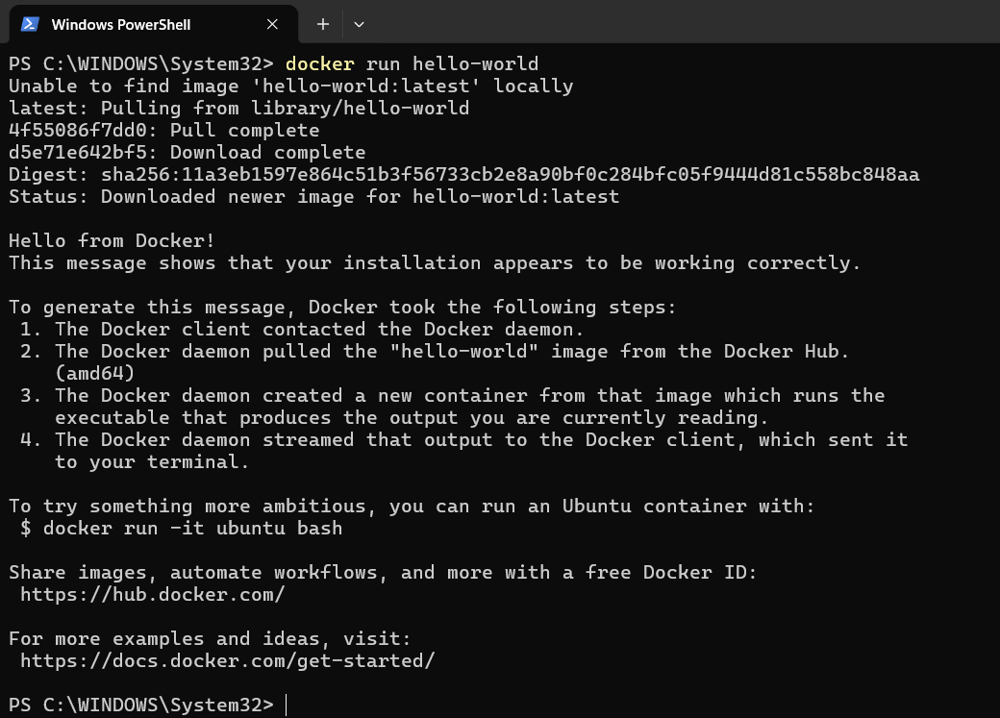

Antes de que funcionara aparecieron dos errores:

| Error | Causa | Solución |
| --- | --- | --- |
| `docker : El término 'docker' no se reconoce...` | Docker todavía no estaba instalado | Instalarlo con `winget` y abrir una terminal nueva |
| `failed to connect to the docker API at npipe:////./pipe/dockerDesktopLinuxEngine` | El motor de Docker Desktop no estaba encendido | Abrir Docker Desktop y esperar a que diga *Engine running* |

## Captura 2: construcción de la imagen

`docker build -t agente-soporte .` terminó en 21.1 segundos, y `docker images` muestra la imagen con 268 MB.

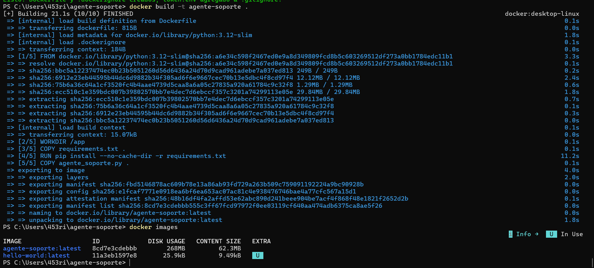

| Paso | Tiempo | Qué hizo |
| --- | --- | --- |
| `[1/5] FROM` | 3.3 s | Descargó `python:3.12-slim` desde Docker Hub |
| `[2/5] WORKDIR` | 0.1 s | Creó `/app` |
| `[3/5] COPY requirements.txt` | 0.1 s | Copió la lista de librerías |
| `[4/5] RUN pip install` | 11.2 s | Instaló las librerías: es el paso más lento |
| `[5/5] COPY agente_soporte.py` | 0.1 s | Copió el script |

`ENV` y `ENTRYPOINT` no aparecen numerados porque no agregan archivos a la imagen.

### Caché de capas

Repetí la construcción dos veces más para comprobar la caché que explica el Paso 2.2:

| Construcción | Tiempo | Pasos `CACHED` | Pasos que se rehicieron |
| --- | --- | --- | --- |
| Primera | 21.1 s | Ninguno | Todos |
| Sin cambiar nada | 1.0 s | `[2/5]` a `[5/5]` | Ninguno |
| Con un comentario nuevo al final del script | 1.3 s | `[2/5]` a `[4/5]`, incluido `pip install` | Solo `[5/5] COPY agente_soporte.py` |

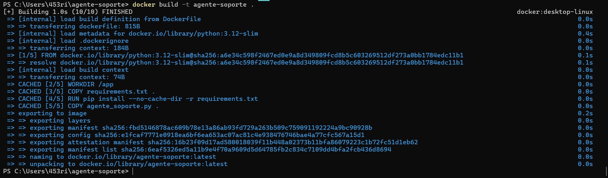

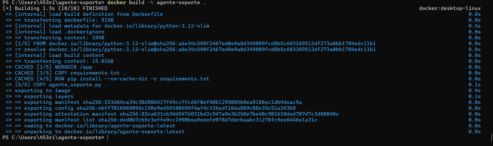

Después borré el comentario y reconstruí. Todo salió `CACHED` y el manifiesto de la imagen (`sha256:fbd5146878…`) quedó idéntico al de la primera construcción, así que la imagen final tiene el script original.

## Captura 3: la imagen no tiene secretos

`docker run --rm --entrypoint ls agente-soporte -A /app` creó un contenedor temporal que, en lugar del agente, ejecutó `ls`. En `/app` solo están los dos archivos que copia el Dockerfile.

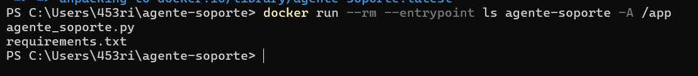

```
agente_soporte.py
requirements.txt
```

No entró el `.env`, `client_secrets.json`, `token_usuario.json` ni `.env.example`, aunque todos estaban en la carpeta del proyecto al construir.

## Captura 4: ejecución con --una-vez

### Paso 4.1: el archivo token.env

`token.env` se generó a partir de mi `token_usuario.json`, en una sola línea con el formato `GOOGLE_TOKEN_JSON={...}`. La captura muestra solo los nombres de los campos, no sus valores. `git check-ignore` confirma que la línea 3 del `.gitignore` impide subirlo a GitHub.

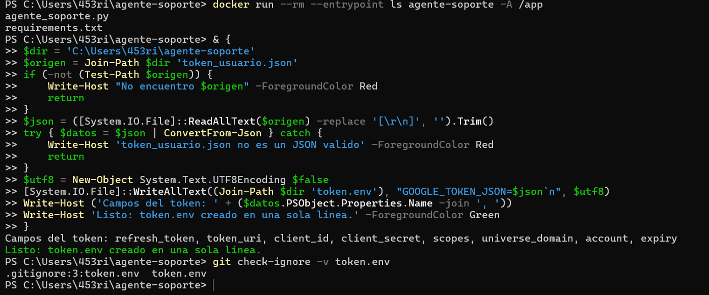

### Paso 4.2: el agente corre una vez

```powershell
docker run --rm --env-file .env --env-file token.env agente-soporte --una-vez
```

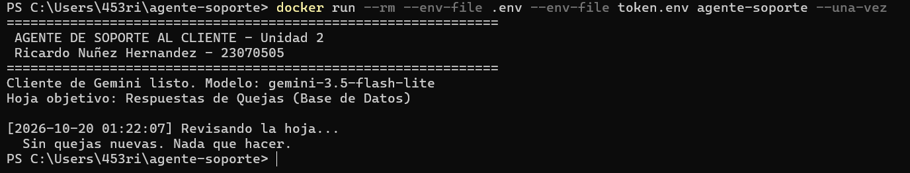

```
Cliente de Gemini listo. Modelo: gemini-3.5-flash-lite
Hoja objetivo: Respuestas de Quejas (Base de Datos)

[2026-10-20 01:22:07] Revisando la hoja...
  Sin quejas nuevas. Nada que hacer.
```

El contenedor recibió los dos secretos, entró a la hoja, revisó y terminó solo; con `--rm` se borró al acabar. La hora está en UTC (01:22), 6 horas adelante del centro de México (19:22 del 19 de octubre). En ese momento no había quejas pendientes; la prueba con una queja real está en la Captura 5.

## Captura 5: modo continuo y prueba de punta a punta

### El contenedor en segundo plano

```powershell
docker run -d --name agente --restart unless-stopped --env-file .env --env-file token.env agente-soporte
```

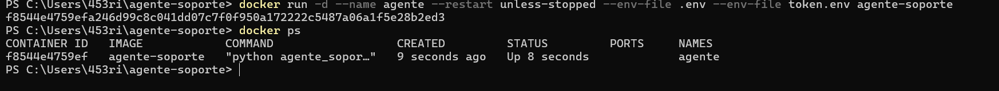

Sin `--una-vez`, el agente entra en modo continuo y revisa la hoja por su cuenta:

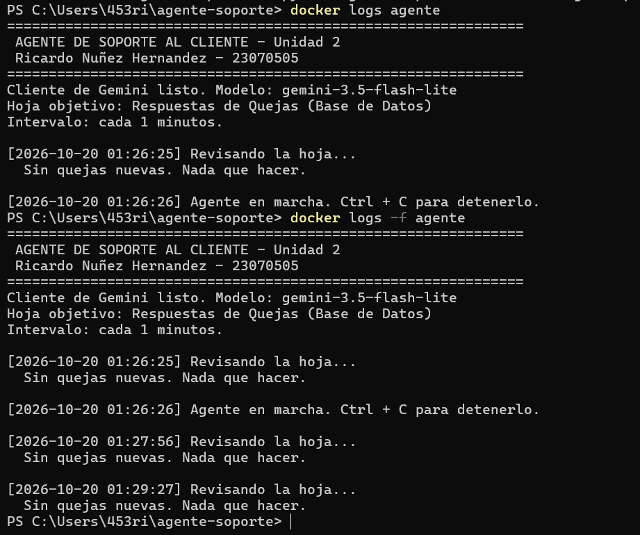

Las revisiones llegaron cada 90 segundos aproximadamente, no cada 60. El script revisa cada 30 segundos si ya pasó el minuto (`time.sleep(30)`), así que en teoría debería revisar cada 61 segundos más o menos. En Docker Desktop la comprobación del segundo 60 cayó justo antes de la hora programada y el agente esperó otra vuelta de 30 segundos.

### Una queja procesada por el contenedor

Para que el contenedor fuera quien procesara la prueba, deshabilité el workflow de la Práctica 2 en GitHub Actions y envié una queja nueva desde el formulario.

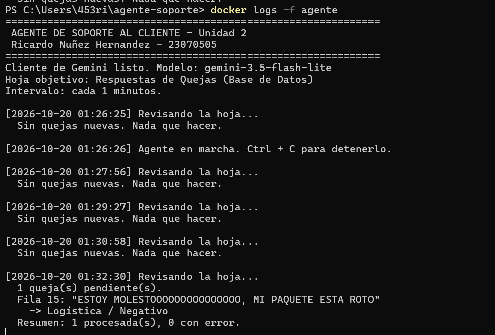

```
[2026-10-20 01:32:30] Revisando la hoja...
  1 queja(s) pendiente(s).
  Fila 15: "ESTOY MOLESTOOOOOOOOOOOOOOO, MI PAQUETE ESTA ROTO"
    -> Logística / Negativo
  Resumen: 1 procesada(s), 0 con error.
```

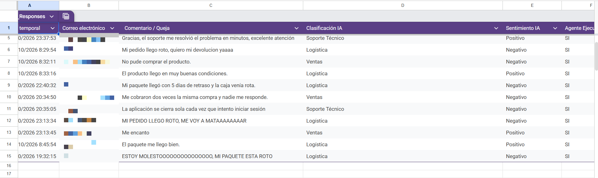

Los correos de la columna B están difuminados porque este repositorio es público.

| Momento (centro de México) | Qué pasó |
| --- | --- |
| 19:32:15 | El formulario guardó la queja en la fila 15 |
| 19:32:30 (01:32:30 UTC) | El contenedor la encontró, Gemini la clasificó y el agente escribió `Logística`, `Negativo` y `SI` en las columnas D, E y F |

El script imprime `-> Logística / Negativo` en lugar del `[OK] Resultado escrito en la fila N` que menciona el PDF, pero el resultado es el mismo.

### Administrar el contenedor

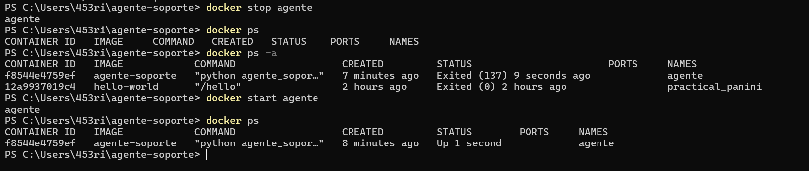

`docker stop agente` tardó unos 10 segundos y el contenedor terminó con `Exited (137)`. Python corre como el proceso principal del contenedor y no responde a la señal de apagado que manda Docker, así que a los 10 segundos Docker lo detiene a la fuerza. No daña nada: si estaba a mitad de una queja, la fila queda sin `SI` y se procesa en la siguiente revisión. `docker start agente` volvió a arrancar el mismo contenedor (`f8544e4759ef`) con su configuración original.

Al terminar la práctica detuve el contenedor y volví a activar el workflow de GitHub Actions, para que no revisen la misma hoja los dos a la vez.

## Archivos subidos a GitHub (Paso 5.5)

El `Dockerfile`, el `.dockerignore` y el `.gitignore` actualizado también se subieron al repositorio del agente. En el mismo commit dejé `.env.example` con el valor de ejemplo `TU_API_KEY_AQUI`. `git status` confirmó que `token.env` y los demás secretos no aparecían antes del commit.

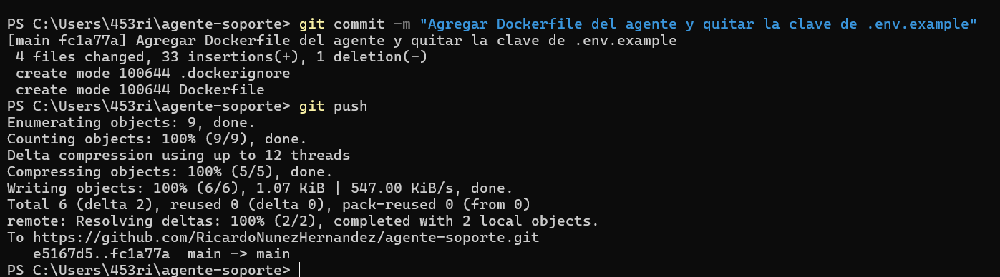

## Preguntas de reflexión

### 1. Explicar con un ejemplo propio la diferencia entre una imagen y un contenedor.

La imagen es el paquete de solo lectura: `agente-soporte` pesa 268 MB y contiene Linux, Python 3.12, las librerías y mi script. Un contenedor es esa imagen en ejecución, con su propio estado, aislado de los demás y de mi computadora. En esta práctica creé varios contenedores distintos a partir de la misma imagen:

| Contenedor | Comando | Qué hizo |
| --- | --- | --- |
| Temporal de `ls` | `docker run --rm --entrypoint ls agente-soporte -A /app` | Listó `/app` y se borró |
| Ejecución única | `docker run --rm ... agente-soporte --una-vez` | Revisó la hoja una vez y se borró |
| `agente` | `docker run -d --name agente ... agente-soporte` | Se quedó corriendo; lo detuve y lo volví a arrancar |

Al borrar los contenedores la imagen siguió intacta, lista para crear otro. Es como un programa instalado y sus ventanas: el programa es uno solo (la imagen), pero puedo abrir varias ventanas a la vez (los contenedores), cada una con lo suyo, y cerrarlas no desinstala el programa.

### 2. Si el .dockerignore no excluyera el archivo .env y la imagen se publicara en Docker Hub, ¿qué podría hacer otra persona con ella?

En mi caso el `.env` no entraría de todos modos, porque el Dockerfile solo copia dos archivos por nombre; el `.dockerignore` es una segunda protección. Pero si el Dockerfile usara `COPY . .`, que es muy común, el `.env` quedaría dentro de `/app`. Cualquiera podría descargar la imagen con `docker pull` y leer el archivo con:

```
docker run --rm --entrypoint cat <imagen> /app/.env
```

Con mi `GEMINI_API_KEY` podría gastar mi cuota gratuita (20 peticiones al día), o generarme cobros si tuviera la facturación activa. Los otros secretos serían todavía más graves:

| Si se colara... | Qué podría hacer otra persona |
| --- | --- |
| `token_usuario.json` o `token.env` | Entrar a mi Google Drive y a mis hojas con los permisos que pide el agente (`spreadsheets` y `drive`), porque traen el `refresh_token` junto con el `client_id` y el `client_secret`. Podría leer las quejas y los correos de los clientes, modificarlos o borrarlos |
| `client_secrets.json` | No abriría mi Drive por sí solo, porque le falta mi token. Pero podría hacerse pasar por mi app de Google para pedir permisos a otras personas y gastar la cuota de mi proyecto |

Corregir la imagen después no basta, porque quien ya la descargó conserva la versión con el secreto. La única solución sería revocar lo que se filtró: la clave en Google AI Studio, el token quitando el acceso de la app en mi cuenta de Google, y el `client_secret` en Google Cloud.

### 3. ¿Por qué el Dockerfile copia requirements.txt antes que el script? ¿Qué se observó en el Paso 3.1 al reconstruir la imagen?

Docker guarda cada instrucción como una capa en caché y solo rehace una capa si cambió lo que copia o algo de lo anterior. Las librerías cambian poco y tardan mucho en instalarse; el script cambia seguido y se copia en un instante. Si `requirements.txt` va primero, un cambio en el script solo invalida la última capa, y `pip install` se reutiliza.

Lo que observé:

- La primera construcción tardó 21.1 s, de los cuales 11.2 s fueron de `pip install`.
- Sin cambios, la reconstrucción tardó 1.0 s y los pasos `[2/5]` a `[5/5]` salieron `CACHED`.
- Con un comentario nuevo en el script tardó 1.3 s: `pip install` siguió `CACHED` y solo se rehízo `[5/5] COPY agente_soporte.py`.

Si el Dockerfile copiara todo junto desde el principio, cualquier cambio al script volvería a instalar todas las librerías.

### 4. ¿Por qué la misma imagen puede ejecutarse en modo continuo o con --una-vez sin construir dos imágenes distintas?

Porque el `ENTRYPOINT` está en formato de lista JSON (`["python", "agente_soporte.py"]`), y todo lo que se escribe después del nombre de la imagen en `docker run` se agrega al final de ese comando:

| Comando | Lo que ejecuta el contenedor |
| --- | --- |
| `docker run ... agente-soporte --una-vez` | `python agente_soporte.py --una-vez` |
| `docker run ... agente-soporte` | `python agente_soporte.py` |

El script decide el modo leyendo sus argumentos: `MODO_UNA_VEZ = "--una-vez" in sys.argv` (línea 84). Con `--una-vez` hace una pasada y termina; sin él, usa `schedule` para revisar cada minuto. El modo lo elijo al ejecutar, no al construir. Incluso `--entrypoint ls` reemplazó el programa completo sin tocar la imagen.

### 5. Si el token de Google se renueva, ¿por qué no basta con docker restart agente?

Porque Docker lee los archivos de `--env-file` solo al crear el contenedor, con `docker run`, y guarda esas variables en la configuración del contenedor. `docker restart` y `docker start` reutilizan el mismo contenedor con las variables que leyó en su momento. Lo comprobé: después de `docker stop` y `docker start`, el contenedor seguía siendo el mismo (`f8544e4759ef`, creado 8 minutos antes). Con el token viejo, el agente fallaría con `invalid_grant` en cada revisión.

Lo correcto es actualizar `token.env`, borrar el contenedor con `docker rm -f agente` y crearlo de nuevo con el comando del Paso 5.1. No hace falta reconstruir la imagen, porque el token nunca estuvo dentro; solo si cambiara el código habría que ejecutar `docker build` antes.

### 6. Para este agente, ¿cuándo convendría usar GitHub Actions y cuándo un contenedor en un servidor? Considerar costo, frecuencia de revisión y facilidad de mantenimiento.

| Aspecto | GitHub Actions | Contenedor en un servidor |
| --- | --- | --- |
| Costo | Gratis dentro de la cuota: cada 30 minutos son 1,440 de los 2,000 minutos al mes que GitHub Free da a mi cuenta para repositorios privados (1,488 en meses de 31 días) | Necesita una máquina encendida todo el tiempo: mi computadora con Docker Desktop abierto, o un servidor que normalmente cuesta unos dólares al mes |
| Frecuencia | El cron pide cada 30 minutos, pero GitHub retrasa o descarta corridas: el 19 de octubre, hasta las 19:30, solo hizo 4 (a las 01:52, 09:41, 14:44 y 17:57, hora del centro de México) | Revisa cada 1 a 1.5 minutos; la queja de prueba se procesó 15 segundos después de enviarla |
| Mantenimiento | GitHub prepara Python y las librerías en cada corrida. Me avisa por correo si una corrida termina con `exit 1`, que pasa cuando no se puede leer la hoja o falla el token; un error de Gemini en una fila no lo activa. Cada corrida es un proceso nuevo, así que una fila que falló se reintenta en la siguiente | Yo me encargo de reconstruir la imagen si cambia el código, recrear el contenedor si cambia el token y revisar `docker logs`, porque en modo continuo un error no detiene el contenedor: sigue en `Up`. Una fila que falla no se reintenta hasta reiniciar el contenedor |

Para este agente, con pocas quejas al día y sin necesidad de respuesta inmediata, conviene GitHub Actions: es gratis, no necesita una máquina encendida, avisa cuando no puede leer la hoja y reintenta solo las filas que fallaron. Un contenedor en un servidor convendría si la tienda necesitara contestar en minutos, si llegaran muchas quejas o si no quisiera depender de los retrasos del cron de GitHub. En los dos casos la cuota gratuita de Gemini (20 peticiones al día) sigue siendo el límite real: revisar más seguido no permite clasificar más quejas.
